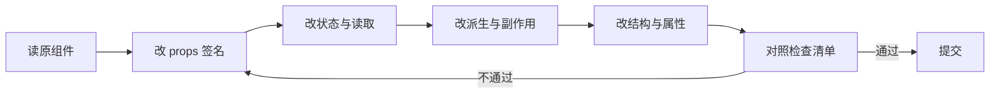

# 项目级迁移方案

## 边界原则

React 与 Solid 的 JSX 语法相似，但编译产物与运行时 ownership 不兼容，**不能在同一组件树中混用**。

可选的边界：

| 边界 | 适用 | 代价 |
| --- | --- | --- |
| 路由 / 页面 | 常规做法，边界清晰 | 需要路由层同时支持两种渲染器 |
| 独立应用根 | 子系统或微前端 | 两套运行时并存 |
| Island | 静态站点局部交互 | 需要 SSR 框架支持 |

从叶子组件开始改，边界随迁随收。不要先改根组件。

## 迁移顺序

1. **搭 Solid 应用壳**：确定构建、路由与渲染模式（CSR / SSR）。
   - 验证：空壳能启动，路由跳转正常。
2. **搬框架无关代码**：类型、校验、数据客户端、纯工具函数。
   - 验证：原 React 侧仍能引用同一份实现。
3. **改叶子 UI 组件**：先无状态展示组件，再带局部状态的组件。
   - 验证：逐组件比对渲染结果与交互。
4. **搬共享状态与 Context**：等消费方已有明确的 Solid 边界后再动。
   - 验证：跨组件更新正常，无模块级 signal。
5. **重写派生与副作用**：按职责拆分，不按依赖数组翻译。
   - 验证：无多余 effect，无同步副本。
6. **迁异步读取**：数据读取、加载态、错误态、mutation。
   - 验证：独立请求不产生额外瀑布，`Loading` / `Errored` 覆盖所有读取点。
7. **下线旧边界**：确认无子组件引用后删除 React 根或路由。

## 单组件改写循环

一次只改一个组件，改完立即验证。批量改写会让错误定位成本成倍上升。

## 高风险点

| 风险 | 表现 | 处理 |
| --- | --- | --- |
| 顶层副作用 | 组件体里直接读 signal 存变量 | 挪进 JSX、memo 或 effect compute |
| effect 泛滥 | 每个 `useEffect` 都有一条对应的 `createEffect` | 先判断是否为派生或事件逻辑 |
| 状态双写 | signal 与 effect 同步另一个 signal | 改为函数或 `createMemo` |
| 全局单例 | 模块顶层 `createSignal` | 移入根组件 + context |
| 列表重建 | 直接 `map` 渲染响应式数组 | 改 `For` 并明确 keying |
| 清理失配 | 清理未绑定到有效 owner | 生命周期用 `onSettled` 初始化并返回清理 |
| 第三方 React 组件 | 直接嵌入 Solid 树 | 保持在该区域外的独立根 |

## 验收清单

- [ ] 组件体内没有依赖响应的顶层读取
- [ ] 所有 signal 读取带括号
- [ ] 可变 props 未被解构
- [ ] 派生值没有独立存储
- [ ] 每个 effect 都对应一个外部系统
- [ ] 列表使用 `For` 或 `Repeat`，不再依赖 `key`
- [ ] 异步读取点都有加载与错误边界
- [ ] 生命周期清理由 `onSettled` 返回值注册，或位于有 owner 的自定义 primitive
- [ ] 无模块级响应式单例
- [ ] 组件树中没有混入 React 运行时组件

## 常见误判

- **“语法几乎一样，可以直接复制”**：语法能过编译，语义会静默出错，尤其是顶层读取与 props 解构。
- **“先批量替换 API 名再修 bug”**：错误会被稀释在大量文件中，定位困难。
- **“Solid 也需要 useCallback”**：组件不重渲染，函数引用稳定性没有意义。
- **“effect 数量对等才算迁移完整”**：Solid 中多数 effect 应被删除而非翻译。
