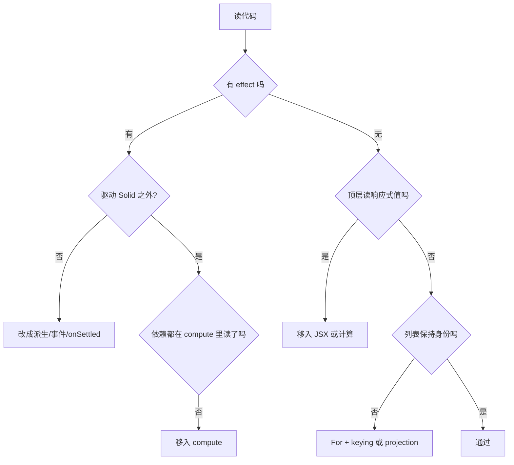

# SolidJS 2 最佳实践

## 前提

- 运行时：SolidJS 2.x。文中 `onSettled`、两阶段 `createEffect`、`Loading` / `Errored` / `Reveal` 均为 2.0 API，1.x 中不存在或签名不同。
- 包：核心与 store 来自 `solid-js`；`@solidjs/web` 提供 DOM 渲染、`Portal`、`dynamic` 与 JSX 类型。
- 示例：`.tsx`，省略与主题无关的导入与类型定义。

## 模型

一个 signal 持有一个值，并记录读取它的作用域。
写入不会立刻传播：Solid 把变更暂存，在微任务中一次性提交。

依赖记录发生在活跃的追踪计算中。常见入口：

1. JSX 表达式
2. `createMemo` 的函数
3. `createEffect` 的 compute 函数
4. 函数形式 `createSignal` / `createStore`、projection 的派生函数
5. 异步计算首次 `await` 之前的同步段

组件体不是追踪作用域，只执行一次。在组件体顶层读取响应式值得到的是快照。

## 写代码的顺序

按问题类型分流，不同类型可叠加：

| 问题 | 先选 | 升级条件 |
| --- | --- | --- |
| 值能由现有状态算出 | 普通函数 | 多处读取、昂贵、需要相等性边界 → `createMemo` |
| 值来自请求 | 异步 `createMemo` | 集合需要保持 item 身份 → 函数形式 `createStore` / `createProjection` |
| 用户操作触发 | 事件处理器内直接执行 | 写入跨越异步等待 → `action` |
| 一次性初始化与清理 | `onSettled` | 需要跟踪后续变化 → `createEffect` |
| 驱动 Solid 之外的系统 | `createEffect(compute, effect)` | 无 |

只有最后一行需要 effect。其余场景出现 effect，几乎都说明选择错了层级。

## 状态容器

| 需求 | 选择 | 理由 |
| --- | --- | --- |
| 单个值，整体替换 | `createSignal` | 最轻，按值订阅 |
| 嵌套对象、按字段更新 | `createStore` | 按属性订阅，draft 写入 |
| 可被用户覆盖、又跟随上游 | `createSignal(() => props.x)` | 可写派生，自动失效 |
| 表单多字段、需要重置 | `createStore(() => props.data)` | store 版可写派生 |
| 服务端返回的集合需要保持身份 | `createProjection` | 按 id 匹配，避免整行重建 |
| 只需要派生出的子集 | 普通函数或 `createMemo` | 不要复制第二份状态 |

判断依据是数据形状与更新方式，不是数据大小。

## 反模式

| 写法 | 问题 | 修正 |
| --- | --- | --- |
| `const [subtotal, setSubtotal]` + effect 同步 | 派生状态慢一个 flush，中间帧不一致 | 直接写派生函数 |
| 组件体顶层 `count()` | 只读一次，不再更新 | 读取移入 JSX 或计算 |
| 解构 `props` | 丢失响应性 | 保留 `props.x` |
| signal 当 flag，用 effect 监听 | 重复点击失效，逻辑远离触发点 | 事件处理器直接执行 |
| effect 里读依赖 | effect 函数不追踪 | 读取放进 compute 阶段 |
| 请求写在 effect 里再写回 signal | 请求、结果、加载态三份状态要手工同步 | 异步 `createMemo` |
| `map` 渲染响应式列表 | 每次整体重建 | `For` 并保持 item 身份 |
| `when={count()}` 判断 0 | 0 与空串是假值，误渲染 fallback | 显式比较，如 `count() !== undefined` |
| ref 回调里建 effect | ref 回调无 owner，永不销毁 | 在组件 setup 建 effect，ref 只存节点 |
| store 直接赋值 `store.x = v` | 写入被静默忽略 | 用 setter 的 draft |
| 模块顶层建 signal 共享状态 | 无 owner，SSR 跨请求泄漏 | 根组件 + context |

## 异步组织

- **请求位置由性能决定**：越靠树上层，启动越早，越容易与其他请求并行。
- **阻塞位置由设计决定**：`Loading` 放得越低，fallback 覆盖区域越小。
- 传值不产生开销：把 accessor 或值向下传，中间组件不必感知异步。
- 组件嵌套本身不制造瀑布，只有数据依赖会。
- 所有响应式输入在首次 `await` 前读完，否则后续变化无法唤醒计算。
- 更新中的旧结果默认保留可见，需要指示时读 `isPending`。

## 审查流程

## 索引

| 文件 | 内容 |
| --- | --- |
| `references/reactivity.md` | 追踪、派生、memo、effect 两阶段、写入时序、owner 与清理 |
| `references/components.md` | JSX 执行、props、children、ref 与指令、class、列表、条件、context |
| `references/state-and-async.md` | store 与 draft、projection、异步计算、边界、action 与乐观更新 |
| `references/anti-patterns.md` | 反模式目录：错误写法、诊断信号、修正方式 |

## 自检

- 每个 effect 都能说清它驱动的是哪个外部系统。
- 不存在由 effect 写入的派生 signal。
- 组件体顶层没有响应式读取。
- props 未被解构。
- 列表的 item 身份在更新间保持稳定。
- 异步计算的输入在首次 `await` 前读取。
- 写入只发生在事件、action、effect 函数或 `onSettled` 中。
- 需要清理的资源都绑定了有效 owner。
